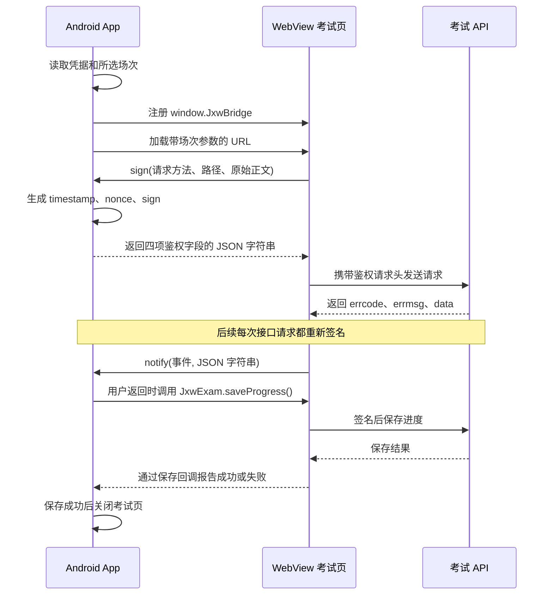

# App 与 WebView 考试页开发对接文档

- 版本：1.0
- 更新日期：2026-10-29
- 对应 App：安卓考试测试壳 1.8
- 适用方式：默认「原生接口注入」，模式值为 `native`

App 端职责及逐项参数来源另见 [App 端职责、WebView 传入值及来源说明](app-side-webview-integration.md)。

## 1. 对接目标与分工

App 在加载考试页之前注册原生 JavaScript 接口 `window.JxwBridge`。网页在每次调用考试 API 前，把请求信息交给 App 签名；App 返回鉴权字段，网页负责把这些字段放入请求头并发送请求。

| 参与方 | 职责 |
| --- | --- |
| Android App | 管理租户凭据、打开指定场次、提供签名、处理网页事件、返回前等待保存、显示联调信息及校时 |
| WebView 中的 H5 | 解析考试参数、加载试卷和题目、播放听力、作答、保存和恢复进度、发起交卷、通知宿主 |
| 考试 API | 验签、校验场次和凭证、提供考试数据、保存答案、处理交卷和评分 |

当前测试壳直接使用预配置的 HSK1～HSK6 场次，不在 App 内动态建场，也不展示成绩。正式宿主应先创建或取得有效场次，再按本文打开考试页。

## 2. 整体调用流程



`timestamp`、`nonce`、`sign` 是每次请求时生成的，不是打开 WebView 时一次性传入的固定参数。

## 3. 默认方式、凭据来源与页面地址

### 3.1 默认方式

首次安装、没有保存过方式或保存值无法识别时，使用原生接口注入。手动切换过方式后，App 保留上次选择；需要按本文联调时，应在首页确认选择「原生接口注入」。

### 3.2 凭据来源

App 优先使用原生「接入配置」保存的 `appId/appKey`；没有保存值时使用 `ExamConfig.defaultCredentials`。其构建默认值由不入库的 `integration.local.properties` 生成到 BuildConfig，配置模板为根目录的 `integration.example.properties`。未填写本机配置时只有无效占位值。自定义值通过 Android Keystore 的 AES-GCM 密钥加密后存入应用私有存储。

本测试壳按联调需求支持显示凭据，也支持通过 `getCredentials()` 主动读取原始凭据。正常的考试 API 鉴权直接调用 `sign()`，不要求网页先读取或自行处理 key。本文示例使用占位值，不复制实际联调密钥。

### 3.3 环境地址

| 项目 | 地址 |
| --- | --- |
| 考试页入口 | `https://staging-public.hskmock.com/hskmock_webview/index.html` |
| 考试 API 根地址 | `https://staging-api.hskmock.com` |

打开地址格式：

```text
https://staging-public.hskmock.com/hskmock_webview/index.html#/exam?examination_id=<场次ID>&exam_token=<场次凭证>&title=HSK1&paper_kind=mock
```

| 参数 | 必填 | 说明 |
| --- | --- | --- |
| `examination_id` | 是 | 场次 ID，全程按字符串处理 |
| `exam_token` | 是 | 当前场次凭证，与场次及租户对应 |
| `title` | 否 | 考试标题 |
| `paper_kind` | 否 | 模拟考为 `mock`；H5 未传时按 `mock` 处理 |

`index.html` 保留在 `#` 前。默认原生模式不会在页面 URL 中追加 `appId/appKey`；考试参数位于 hash 路由的 query 中。

H5 解析示例：

```javascript
const query = window.location.hash.split('?')[1] || '';
const params = new URLSearchParams(query);
const examinationId = params.get('examination_id');
const examToken = params.get('exam_token');

if (!examinationId || !examToken) {
  throw new Error('缺少考试参数 examination_id / exam_token');
}

// examinationId 保持字符串，不使用 Number、parseInt 或浮点数转换。
```

## 4. Android 端初始化要求

### 4.1 WebView 设置

| 配置 | 当前值 | 用途 |
| --- | --- | --- |
| JavaScript | 开启 | 执行考试页面和桥调用 |
| DOM Storage | 开启 | 支持页面存储和续考相关状态 |
| 无手势音频播放 | 允许 | 支持听力播放；系统仍拦截时由 H5 提示点按播放 |
| 宽视口、自适应缩放 | 开启 | 按可用宽度展示试卷 |
| 文件及 Content 访问 | 关闭 | 当前考试页使用 HTTPS 资源 |
| WebView 调试 | 仅 debug 开启 | 联调查看页面及请求 |

当前宿主导航限定为测试站考试入口，API 请求由网页向 API 域名发起。

### 4.2 注册顺序

关键顺序如下，完整实现见 `ExamActivity.createExamWebView()`：

```kotlin
// 1. 读取所选场次和租户凭据。
// 2. 创建 WebView 并配置 JavaScript、存储、音频等。
// 3. 注册带 @JavascriptInterface 的 ExamHostBridge。
webView.addJavascriptInterface(bridge, "JxwBridge")

// 4. 注册完成后才加载考试页。
webView.loadUrl(examUrl)
```

原生模式直接向网页注册 `window.JxwBridge`，不需要额外创建 `window.HostBridge`，也不依赖网页加载完成后的 JS 包装脚本。

Android JavaScript 接口方法在 WebView 桥线程执行。`sign()` 同步完成字符串计算；页面事件、关闭和 UI 更新应转到主线程。不要在 `sign()` 中调用 `evaluateJavascript()` 或等待主线程操作。

## 5. 原生接口定义

| 接口 | 调用方 → 接收方 | 返回值或作用 |
| --- | --- | --- |
| `JxwBridge.getTransferMode()` | H5 → App | 同步返回模式字符串，默认为 `native` |
| `JxwBridge.getCredentials()` | H5 → App | 同步返回凭据 JSON 字符串 |
| `JxwBridge.sign(payload)` | H5 → App | 同步返回鉴权字段 JSON 字符串 |
| `JxwBridge.notify(event, payload)` | H5 → App | 通知考试业务事件，无业务返回值 |
| `JxwBridge.progressSaved(requestId, success)` | 宿主注入的保存脚本 → App | 完成宿主等待中的保存操作 |
| `JxwExam.saveProgress()` | App → H5 | H5 提供，返回 `Promise<boolean>` |

### 5.1 `getTransferMode()`

```javascript
const mode = window.JxwBridge.getTransferMode();
// 默认原生接口模式返回：'native'
```

### 5.2 `getCredentials()`：可选读取能力

```javascript
const credentials = JSON.parse(window.JxwBridge.getCredentials());
// { appId: '<租户应用标识>', appKey: '<租户密钥>' }
```

| 字段 | 类型 | 注意事项 |
| --- | --- | --- |
| `appId` | string | 这里使用驼峰名称；鉴权请求头使用小写 `appid` |
| `appKey` | string | 原始密钥；开放 API 请求不携带此字段 |

只有原生接口模式且凭据可用时返回这两个字段，其他情况返回字符串 `"{}"`。该接口需要 H5 主动调用，不会自动在页面上生成全局 `appId/appKey` 变量。

当前线上考试的标准链路直接调用 `sign()`。读取原始凭据是测试壳提供的扩展能力，不是签名前置步骤。

### 5.3 `sign(payload)`：请求签名

入参 `payload` 为 JSON 字符串，三个字段都需要传入：

```json
{
  "method": "GET",
  "requestUrl": "/mock/open/exams/<场次ID>/paper?exam_token=<场次凭证>",
  "body": ""
}
```

| 字段 | 类型 | 约定 |
| --- | --- | --- |
| `method` | string | 大写 `GET` 或 `POST` |
| `requestUrl` | string | API 路径加原始 query，不包含域名或 `#` |
| `body` | string | 实际发送的原始 JSON 正文；没有正文时必须为 `""` |

当前桥只为所选场次的 `/mock/open/exams/<当前场次ID>/...` 路径签名，不是通用租户 API 签名入口。创建场次、等级、权益等接口不通过本考试页桥调用。

成功返回 JSON 字符串：

```json
{
  "appid": "<租户应用标识>",
  "timestamp": "<当前Unix秒>",
  "nonce": "<16位字母数字串>",
  "sign": "<32位MD5大写十六进制>"
}
```

凭据缺失、参数不合法、请求路径不属于当前场次或签名异常时，当前桥返回字符串 `"{}"`。H5 应检查返回字段并展示签名失败，不继续发送缺少鉴权字段的请求。

### 5.4 签名规则

App 按以下六段使用单个换行符 `\n` 拼接：

```text
Method
RequestUrl
RequestBody
Timestamp
Nonce
appKey
```

然后对 UTF-8 字节计算 MD5，转换为 32 位大写十六进制。

- 无 Body 时第三段为空，待签串仍保留这一空行。
- `appKey` 后不添加换行。
- query 的顺序和百分号编码保持原样，不排序、不重新编码已经签好的路径。
- POST JSON 只序列化一次，签名与发送使用同一份字符串。
- `timestamp` 为 10 位 Unix 秒；参与签名的值与请求头中的值完全相同。
- `nonce` 每次生成 16 位 `A-Z/a-z/0-9` 字符，不复用旧签名。
- `appKey` 只参与 API 签名，不加入开放 API 的请求头、query 或 Body。

## 6. H5 签名请求示例

以下代码展示请求封装的关键行为。所有请求都通过同一个桥，不需要先调用 `getCredentials()`。

```javascript
const API_ORIGIN = 'https://staging-api.hskmock.com';

async function examRequest({ method, path, query = [], body }) {
  const bridge = window.JxwBridge;
  if (!bridge || typeof bridge.sign !== 'function') {
    throw new Error('JSBridge 未注入：无法完成请求签名');
  }
  if (!['GET', 'POST'].includes(method)) {
    throw new Error('请求方法必须为大写 GET 或 POST');
  }
  if (method === 'GET' && body !== undefined) {
    throw new Error('GET 请求不传 Body');
  }

  // query 使用有序二元数组，保留接口约定的顺序。
  const rawQuery = query.map(([key, value]) =>
    `${encodeURIComponent(key)}=${encodeURIComponent(String(value))}`
  ).join('&');
  const requestUrl = path + (rawQuery ? `?${rawQuery}` : '');

  // JSON 只序列化一次。
  const rawBody = body === undefined ? '' : JSON.stringify(body);
  const rawHeaders = bridge.sign(JSON.stringify({
    method,
    requestUrl,
    body: rawBody
  }));
  const signed = JSON.parse(rawHeaders);
  if (!signed.appid || !/^\d{10}$/.test(signed.timestamp) ||
      !/^[A-Za-z0-9]{16}$/.test(signed.nonce) ||
      !/^[0-9A-F]{32}$/.test(signed.sign)) {
    throw new Error('JSBridge 签名返回格式错误');
  }

  const headers = {
    appid: signed.appid,
    timestamp: signed.timestamp,
    nonce: signed.nonce,
    sign: signed.sign
  };
  const options = { method, headers };
  if (rawBody !== '') {
    headers['Content-Type'] = 'application/json';
    options.body = rawBody;
  }

  const response = await fetch(API_ORIGIN + requestUrl, options);
  const result = await response.json();
  if (!response.ok || result.errcode !== 0) {
    const error = new Error(result.errmsg || `HTTP ${response.status}`);
    error.errcode = Number.isInteger(result.errcode) ? result.errcode : -2;
    throw error;
  }
  return result.data;
}
```

每次重试都重新调用 `examRequest()` 取得新签名，不重放上一次的请求头。HTTP 200 仍可能携带非零业务错误码；成功判断以 `errcode === 0` 为准，不能因为 `errmsg` 非空就判断失败。

五类考试请求如下：

| 业务 | 方法 | 路径 | query 顺序 | Body |
| --- | --- | --- | --- | --- |
| 试卷基础信息 | GET | `/mock/open/exams/{id}/paper` | `exam_token` | 无 |
| 试卷题目 | GET | `/mock/open/exams/{id}/topics` | `exam_token`、`topic_type` | 无 |
| 查看答题记录 | GET | `/mock/open/exams/{id}/answers` | `exam_token` | 无 |
| 保存答案和进度 | POST | `/mock/open/exams/{id}/answers` | `exam_token` | JSON |
| 交卷 | POST | `/mock/open/exams/{id}/submission` | `exam_token` | 无 |

加载试卷示例：

```javascript
const paper = await examRequest({
  method: 'GET',
  path: `/mock/open/exams/${examinationId}/paper`,
  query: [['exam_token', examToken]]
});
```

加载题目时，`topic_type` 来自试卷 `parts`：

```javascript
const topics = await examRequest({
  method: 'GET',
  path: `/mock/open/exams/${examinationId}/topics`,
  query: [
    ['exam_token', examToken],
    ['topic_type', topicType]
  ]
});
```

交卷只能由考生提交或考试最后环节超时等考试业务触发。交卷请求不传 `body`，不设置 `Content-Type`，仍需 App 为此次空正文请求生成新签名。

## 7. 网页事件：H5 → App

调用格式：

```javascript
window.JxwBridge.notify(event, JSON.stringify(payload));
```

第二个参数为 JSON 字符串，不直接传 JS 对象。每个事件都携带字符串类型的 `examination_id`；与宿主当前场次不一致或 JSON 无法解析时，当前 App 忽略该事件。

| event | payload | App 行为 |
| --- | --- | --- |
| `exam_init_failed` | `{ examination_id, errcode, errmsg }` | 显示错误码、原始错误及对应提示；符合条件的时间戳错误会尝试校时 |
| `answer_save_failed` | `{ examination_id }` | 提示自动保存失败、检查网络 |
| `exam_submitted` | `{ examination_id, status }` | `status` 为 `scoring/scored` 时记录交卷成功并提示 |
| `request_close` | `{ examination_id, status }` | `status` 为 `scoring/scored` 时关闭考试页 |

初始化错误示例：

```javascript
try {
  // 执行试卷和题目的初始化请求。
} catch (error) {
  window.JxwBridge.notify('exam_init_failed', JSON.stringify({
    examination_id: examinationId,
    errcode: Number.isInteger(error.errcode) ? error.errcode : -2,
    errmsg: error.message || '试卷初始化失败'
  }));
}
```

交卷 API 成功后，网页依次通知：

```javascript
const payload = JSON.stringify({
  examination_id: examinationId,
  status: submission.status // 服务端返回的 scoring 或 scored
});
window.JxwBridge.notify('exam_submitted', payload);
window.JxwBridge.notify('request_close', payload);
```

App 不解析总分和分项，也不在交卷后打开成绩页。

## 8. 保存、退出和续考：App → H5

### 8.1 H5 提供保存函数

页面应挂载：

```javascript
window.JxwExam = {
  saveProgress: async function () {
    try {
      // 从页面考试状态构造答案与完整进度，不在此处调用交卷接口。
      const progress = buildProgressPayload();
      const data = await examRequest({
        method: 'POST',
        path: `/mock/open/exams/${examinationId}/answers`,
        query: [['exam_token', examToken]],
        body: progress
      });
      return data.saved === true;
    } catch (error) {
      window.JxwBridge.notify('answer_save_failed', JSON.stringify({
        examination_id: examinationId
      }));
      return false;
    }
  }
};
```

`buildProgressPayload()` 由 H5 按实际考试状态实现，不是宿主提供的接口。数字进度字段应整组保存，包括值为 `0` 的字段，避免省略后被服务端写为空。主要字段为：

```text
answers、count_down、segment_code、audio_index、audio_current_time、
anchor_index、current_question_id、phase、resource_version、
abbreviation_state、part_question_type
```

`anchor_index` 是听力锚点序号，`audio_current_time` 才是音频播放秒数。题目 `question_id` 对应 `eqid`，客观题答案对应 `eoid`。没有新答案时可传空 `answers` 数组，只更新进度。

### 8.2 App 等待保存完成

用户按系统返回时，当前 App：

1. 生成本次保存操作的 `requestId`。
2. 通过 `evaluateJavascript()` 调用 H5 的 `JxwExam.saveProgress()`。
3. 在注入脚本中等待 Promise 完成，再调用 `JxwBridge.progressSaved(requestId, success)`。
4. 仅接受与当前等待操作匹配的回调；成功后关闭页面。
5. 保存失败或 10 秒未完成时，提供重试、取消和直接离开的选项。

`evaluateJavascript()` 的回调本身不会等待 JS Promise，所以当前实现使用 `progressSaved()` 完成异步回传。`progressSaved()` 是宿主保存流程的内部配套接口，H5 的 `saveProgress()` 只需返回布尔结果，不需要自行生成 requestId 或额外调用它。

页面尚未挂载保存函数时，App 按“没有可调用的保存操作”直接关闭。因此 H5 应在页面生命周期内及时注册保存函数。

已收到有效交卷成功事件时，App 返回直接关闭，不再保存答案。中途返回不会主动交卷。切后台会尽力保存，但系统强制停止进程不能保证最后一次异步保存完成；恢复仍依赖已成功保存的服务端记录。

### 8.3 重新进入同场考试

未交卷场次重新打开后，H5 读取答题记录恢复状态，宿主不修改保存字段。交卷后原场次不能再次加载试卷，需要宿主提供新场次。

## 9. 时间戳校验与自动校时

服务器要求签名时间与其相差不超过 5 分钟。App 默认使用设备当前 Unix 秒；已有有效校准时，使用 HTTPS 校准后的服务器时间。

当前校时行为：

- H5 报告 `errcode=6` 且错误包含 `timestamp` 时，App 自动校时并重载当前场次一次；兼容缺失错误码但消息包含 timestamp 的旧事件。
- 其他业务错误码即使消息提到 timestamp，也不触发此重试。
- App 向同一 API 域名发起带随机 query 的 HTTPS HEAD 请求，读取 `Date`，不携带租户凭据。
- 不跟随重定向、不使用已有缓存；拒绝缓存 Age 大于 0、缺失日期或超过 15 秒的采样。
- API 根路径可能返回 404；有效且未缓存的 Date 仍可作为时间样本。此请求是校时请求，不是加载试卷失败。
- 校准后按 `SystemClock.elapsedRealtime()` 推进时间，有效期为当前进程内 6 小时；过期或进程重启后回到设备时钟。
- 不修改 Android 系统时间，也不关闭 HTTPS 证书校验。

如果校时失败或仍被拒绝，用户可展开“工具 → 时间诊断”，查看设备日期、服务器偏差、签名 timestamp 与最近 API 地址，点击“校时并重试”或进入系统日期和时间设置。

只检测服务器时间不会重载正常考试页；初始化时间戳错误后的自动重试才会重载。校时、网络重试和页面重新初始化都会重新请求签名，不复用原有 sign。

## 10. 错误处理与页面表现

| 情况 | 排查方向 |
| --- | --- |
| 找不到 `JxwBridge` | 检查是否在 loadUrl 前注册、JavaScript 是否开启、是否通过宿主打开 |
| `sign()` 返回 `{}` | 检查凭据、三个入参字段、方法大小写、当前场次路径和设备时间格式 |
| `errcode=6`，含 timestamp | 检查设备日期和绝对时间；查看校时结果；确认使用 Unix 秒 |
| `errcode=6`，其他鉴权错误 | 核对 appId/appKey、租户有效期、原始路径与正文、是否重用了签名 |
| `3008` | 场次不存在或不属于当前租户 |
| `3016` | 场次已交卷，需要新场次 |
| `3025` | exam_token 无效，或与当前 appId/场次不匹配 |
| 续考进度不完整 | 检查保存时数字字段是否缺失、锚点与秒数是否混用 |
| 主网页 HTTP/网络错误 | 检查页面站点和设备网络；与 API 业务错误分别排查 |

当前原生错误页保留错误码和服务端原始 errmsg。图片或音频等子资源失败不会用原生全屏错误遮住整张试卷。

App 的首页和考试页均声明并请求横屏。1.8 使用 targetSdk 36 和官方大屏兼容属性，以适配 Android 16 平板。考试页隐藏 H5 自身的 HSK 标题栏及其顶部占位，原生联调工具默认收起，右上角“工具”可展开查看 URL 和诊断。只展开或收起工具不会重载网页。窗口模式和平台限制说明见项目 README。

考试 Activity 处于前台时保持屏幕常亮，进入后台或退出考试页时清除常亮标记，列表页不设置该标记。

## 11. 联调验收清单

- [ ] 确认本机选择的是“原生接口注入”，`getTransferMode()` 返回 `native`。
- [ ] 页面首段业务脚本能访问 `JxwBridge.sign`。
- [ ] 默认页面 URL 包含完整场次 ID 和 exam_token，没有追加 appId/appKey。
- [ ] 可选的 `getCredentials()` 返回 JSON 字符串，字段为 `appId/appKey`。
- [ ] 每次接口请求的请求头包含四项鉴权字段，不直接传 appKey。
- [ ] timestamp 为当前 Unix 秒，nonce 每次更新，sign 为 32 位大写十六进制。
- [ ] 题目 query 顺序为 exam_token、topic_type；签名与实际发送的正文一致。
- [ ] 无 Body 的 GET/POST 不带 Content-Type；保存 JSON 时带 application/json。
- [ ] 加载基础信息后能看到题目，听力可播放或能按页面提示点按播放。
- [ ] 作答后返回，保存成功才关闭；重新进入未交卷场次时答案和进度恢复。
- [ ] 保存失败或超时会保留选择机会，不自动交卷。
- [ ] 提交成功后发送 exam_submitted、request_close；宿主关闭页面，不展示成绩。
- [ ] timestamp 初始化错误只自动校时重试一次，原始错误和诊断可查看。
- [ ] 展开和收起工具不刷新试卷、不重置听力与答案。

## 12. 实现文件与验证方式

| 文件 | 主要职责 |
| --- | --- |
| [ExamActivity.kt](../app/src/main/java/com/example/nine_scholars_king_test/ExamActivity.kt) | WebView 创建、原生桥注册、事件处理、返回保存、校时与工具栏 |
| [ExamHostBridge.kt](../app/src/main/java/com/example/nine_scholars_king_test/ExamHostBridge.kt) | 五个原生 JS 方法及参数处理 |
| [ExamSigner.kt](../app/src/main/java/com/example/nine_scholars_king_test/ExamSigner.kt) | 六段签名字符串、nonce 和 MD5 |
| [HostCredentialsStore.kt](../app/src/main/java/com/example/nine_scholars_king_test/HostCredentialsStore.kt) | 凭据读取及加密存储 |
| [CredentialTransfer.kt](../app/src/main/java/com/example/nine_scholars_king_test/CredentialTransfer.kt) | 默认模式、模式持久化、传入渠道 |
| [SigningClock.kt](../app/src/main/java/com/example/nine_scholars_king_test/SigningClock.kt) | 校准时钟、单调计时及有效期 |
| [ServerTimeSync.kt](../app/src/main/java/com/example/nine_scholars_king_test/ServerTimeSync.kt) | HTTPS Date 获取 |
| [ExamConfig.kt](../app/src/main/java/com/example/nine_scholars_king_test/ExamConfig.kt) | 环境地址、六个测试场次及 BuildConfig 中本机凭据的引用 |

本机 PowerShell 构建与静态检查：

```powershell
$env:JAVA_HOME = 'C:\Program Files\Android\Android Studio\jbr'
.\gradlew.bat assembleDebug lintDebug testDebugUnitTest
```

连接安卓设备或模拟器后可运行：

```powershell
.\gradlew.bat connectedDebugAndroidTest
```

当前 1.8 包的构建、Lint 和 20 项单元测试已通过；19 项安卓回归测试覆盖横屏、标题隐藏、签名、保存和页面事件。自动化使用本地 HTML 和测试凭据；真实试卷、媒体播放和服务端续考仍应按本节清单在目标设备联调。

接口原始规则参考《模拟考试接口(3)(1).md》和《考试页宿主对接文档》；项目内的签名案例复算与公开前端代码核对记录见 [接口文档核对](api-contract-review.md)。本文只描述默认原生接口注入，另外两种联调传入方式见 [README](../README.md)。
